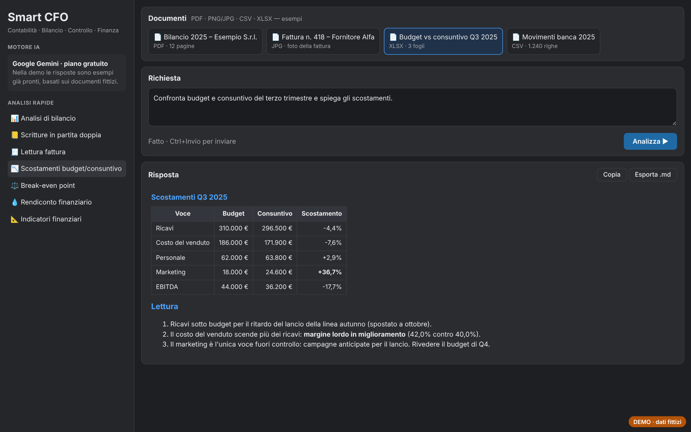
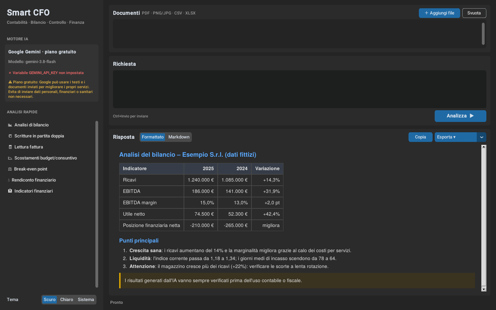

# Smart CFO Assistant

Assistente desktop per contabilità, bilancio, controllo di gestione e finanza: si caricano fatture, bilanci o prospetti e si ottiene un'analisi strutturata, con tabelle e punti d'attenzione.

**[Prova la demo](https://andreapollastrelli95.github.io/smart-cfo-assistant/)** · Analisi rapide su documenti d'esempio, con risposte già pronte. Tutti i dati sono fittizi.




*Esempio di risposta con dati fittizi.*

## Cosa fa

- **Documenti in ingresso**: PDF, immagini (fatture fotografate), CSV ed Excel, letti e passati al modello insieme alla richiesta.
- **Analisi rapide pronte**: analisi di bilancio, scritture in partita doppia, lettura di una fattura, scostamenti budget/consuntivo, break-even point, rendiconto finanziario, indicatori finanziari.
- **Risposta in streaming** con vista formattata (tabelle, elenchi, avvisi) o Markdown, copia ed esportazione in HTML, Markdown e testo.
- **Uso attento della quota gratuita**: modello di riserva se il principale è al limite, pochi tentativi solo per errori temporanei, timeout per operazione.
- **Privacy**: avviso prima di inviare documenti; la chiave API si legge solo dalla variabile d'ambiente `GEMINI_API_KEY` e non viene mai salvata.
- Tema chiaro, scuro o di sistema.

## Come è fatto

| File | Ruolo |
|---|---|
| `main.py` | Interfaccia **CustomTkinter**: documenti, richiesta, risposta, stato; lavoro in background con coda di eventi |
| `ai_client.py` | Chiamate a **Google Gemini** (SDK `google-genai`) in streaming, con modello di riserva e gestione degli errori |
| `ai_config.py` | Modello, limiti e tempi: unico punto da modificare |
| `document_loader.py` | Lettura di PDF (`pypdf`), immagini, CSV ed Excel (`pandas`) |
| `markdown_render.py` | Rendering della risposta in HTML (`markdown`, `tkinterweb`) e esportazioni |
| `config_manager.py` | Preferenze dell'utente (tema) |

## Avviarlo

```powershell
python -m venv .venv
.venv\Scripts\python -m pip install -r requirements.txt
setx GEMINI_API_KEY "la-tua-chiave"     # chiave gratuita da aistudio.google.com/apikey
.venv\Scripts\python main.py            # oppure doppio clic su run.bat
```

> I risultati generati dall'AI vanno sempre verificati prima dell'uso contabile o fiscale.

---

Progetto di [Andrea Pollastrelli](https://andreapollastrelli95.github.io/).
